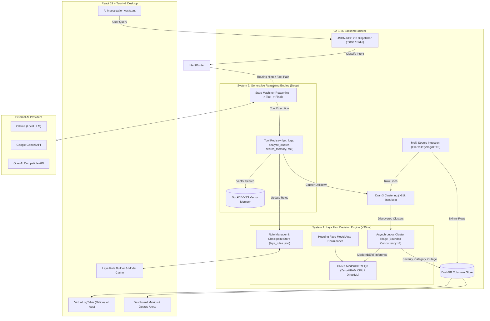
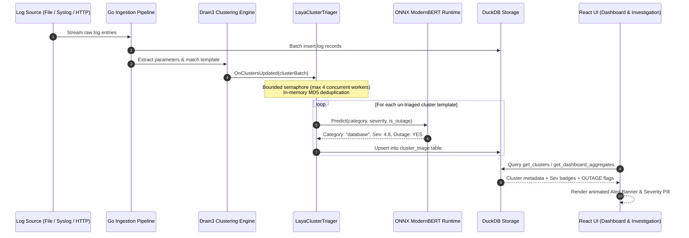

# LogLensAi: High-Performance Log Analysis Cockpit

LogLensAi is a state-of-the-art diagnostic desktop application designed for high-velocity log ingestion, real-time template clustering, and hybrid dual-engine AI investigation. Built with the **Obsidian Lens** design system, it delivers lightning-fast log exploration, instant sub-30ms reactive triage, and autonomous root-cause investigation across millions of log entries.

> **Status:** Personal sandbox / Portfolio piece  
> **License:** MIT License  
> **Purpose:** Academic research, technical skill development, and production-grade AI system exploration.

---

## System Overview
LogLensAi is a multi-runtime desktop log analysis cockpit comprising a React 19 + TypeScript frontend (`src/`), a Rust Tauri v2 desktop supervisor (`src-tauri/`), a Go 1.26.4 sidecar engine (`backend-go/`) backed by DuckDB, Drain3 template mining, local ONNX Laya/RAG models, and LLM orchestration, and Python/PowerShell operational utilities (`scripts/`).

---

## 🏗️ Technical Architecture

LogLensAi is built on a high-throughput **Sidecar Architecture**:

- **Frontend**: [React 19](https://react.dev) + [TypeScript](https://www.typescriptlang.org/) + [Vite 6](https://vitejs.dev) + [Tailwind CSS v4](https://tailwindcss.com) + [Zustand](https://github.com/pmndrs/zustand) + [Lucide Icons](https://lucide.dev).
- **Desktop Shell**: [Tauri v2](https://v2.tauri.app/) (Rust) providing native window controls, hardware isolation, and desktop bridge.
- **Backend Sidecar**: [Go](https://go.dev) `1.26+`, high-performance columnar [DuckDB](https://duckdb.org) (`marcboeker/go-duckdb`), and an in-memory Drain3 template mining engine processing **>81,000 lines/second**.
- **Dual-Engine AI Intelligence**:
  - **System 1 (Laya AI Decision Engine)**: Sub-30ms reactive classification & triage via ONNX ModernBERT (`nvkudva/laya-web-q8`, 524 MB quantized). Runs on **CPU OpenMP (0 MB VRAM)** or **GPU DirectML/CUDA**. Dedicated to real-time cluster triage (category, severity 1–5, outage indicators), automated Hugging Face model downloading, and checkpointed prompt/rubric evolution with 1-click rollback.
  - **System 2 (Generative LLM Engine)**: Multi-step reasoning state machine (`internal/ai/graph/`) with DuckDB-VSS vector memory retrieval and tool execution supporting **Ollama**, **Gemini**, and **OpenAI**.
- **Communication Protocol**: JSON-RPC 2.0 over standard IO (`stdin`/`stdout`) in production desktop mode, and HTTP port `5000` in dev mode.

---

## 🧠 Dual-Engine AI Architecture

LogLensAi bridges cognitive speed and analytical depth through a complementary dual-engine design:



---

## ⚡ Real-Time Log Ingestion & Laya Cluster Triage

During log streaming, the clustering engine continuously groups raw logs into dynamic templates. As clusters are discovered or updated, Laya evaluates their operational impact in background worker threads without throttling ingestion throughput:



---

## ✨ Key Features

- **Blazing Fast Ingestion**: Columnar batch persistence into DuckDB with local disk append storage for millions of entries.
- **Dynamic Drain3 Clustering**: Single-threaded in-memory clustering operating at over **81,000 lines/sec** to prevent IPC overhead.
- **Laya System 1 Triage**:
  - **Zero-VRAM CPU Execution**: Built with OpenMP acceleration so developers with integrated graphics or limited VRAM can run high-accuracy inference locally.
  - **GPU DirectML/CUDA Acceleration**: Optional 1-click toggle for supported hardware.
  - **Live Cluster Triage**: Instantaneous categorization, 1–5 impact rating, and automatic `OUTAGE` risk tagging on cluster lists and dashboard metrics.
  - **Automated Hugging Face Downloader**: Built-in model manager that downloads `nvkudva/laya-web-q8` weights with atomic streaming `.part` files and SHA verification.
  - **Visual Rule Builder & JSON Editor**: Interactive editor for decision rubrics, option choices, and boolean outage criteria.
  - **Checkpoints & 1-Click Rollback**: Fully auditable snapshot history in `config/laya_rules.json` with instant rollback.
  - **AI Auto-Improvement**: System 2 LLM uses the `update_laya_rules` tool to iteratively refine classification rules based on investigation findings.
- **Obsidian Lens UI**:
  - Sleek dark theme (`#0D0F0E`) with `#22C55E` emerald accents.
  - Virtualized table rendering supporting millions of log rows without DOM lag.
  - Interactive Filter Builder, Search Bar with live highlights, and source management.

---

## 🛠️ Tooling & Tech Stack

| Layer | Technology | Purpose |
| :--- | :--- | :--- |
| **Desktop Shell** | Tauri v2 (Rust) | Cross-platform native window management & IPC |
| **Frontend UI** | React 19, TypeScript, Vite 6 | High-performance, reactive UI cockpit |
| **Styling** | Tailwind CSS v4, Lucide Icons | Obsidian Lens design system implementation |
| **State Management** | Zustand | Granular client stores (`investigation`, `dashboard`, `layaStore`) |
| **Backend Engine** | Go 1.26+ | Sidecar process, concurrency, and JSON-RPC API |
| **Log Storage** | DuckDB (`marcboeker/go-duckdb`) | Embedded OLAP analytics and fast log querying |
| **Log Clustering** | Drain3 (Go native port) | Zero-dependency template mining at 81,000 lines/sec |
| **System 1 AI** | ONNX Runtime (`onnxruntime_go`) | Sub-30ms ModernBERT Q8 classification (CPU/DirectML) |
| **System 2 AI** | LangGraph State Machine (Go) | Autonomous multi-step root-cause analysis |
| **Vector Memory** | DuckDB-VSS | Fast in-process embedding similarity search |

---

## 📂 Directory Layout

```text
LogLensAi/
├── src/                          # React 19 Frontend
│   ├── components/               # Atomic Design (atoms, molecules, organisms)
│   │   ├── organisms/            # VirtualLogTable, LayaSettingsPanel, Dashboard, etc.
│   │   └── molecules/            # ClusterRow, FilterBuilder, SearchBar
│   ├── store/                    # Zustand stores (investigationStore, layaStore, etc.)
│   ├── lib/hooks/                # IPC hooks (useSidecarBridge.ts)
│   ├── types/                    # TypeScript interfaces & JSON-RPC contracts
│   └── App.tsx                   # Main 3-column cockpit layout
├── src-tauri/                    # Tauri v2 Shell (Rust)
│   ├── src/                      # Native desktop runner and sidecar supervisor
│   └── tauri.conf.json           # Tauri window and permissions config
├── backend-go/                   # Go Sidecar Engine
│   ├── cmd/sidecar/              # Main sidecar entrypoint (stdio & HTTP :5000)
│   └── internal/
│       ├── ai/                   # AI Orchestration
│       │   ├── laya/             # Laya System 1: ONNX engine, tokenizer, rules, downloader
│       │   ├── graph/            # System 2: LangGraph state machine, tool registry
│       │   └── rag/              # DuckDB-VSS embeddings and vector memory
│       ├── app/                  # RPC handlers (handlers_laya.go, handlers_cluster.go, etc.)
│       ├── db/                   # DuckDB schema, cursor pool, and cluster_triage queries
│       ├── drain3/               # In-memory Drain3 template mining algorithm
│       ├── ingestion/            # File tailers, SSH loaders, and syslog collectors
│       ├── rpc/                  # JSON-RPC 2.0 dispatch and method registry
│       └── services/clustering/  # Drain3 background worker with triage hook
├── config/                       # Configuration & Checkpoint Storage
│   └── laya_rules.json           # Active rules, question rubrics, and checkpoint history
└── docs/                         # System Documentation
    ├── architecture/             # Architecture decision records and interaction diagrams
    └── track/                    # Specs, task tracking, and retrospective logs
```

---

## 🚀 Getting Started

### 1. Prerequisites

- **Go**: [Go](https://go.dev) `1.26+` installed and available in PATH.
- **Node.js & Package Manager**: [Node.js](https://nodejs.org) v20+ with `bun` or `npm`.
- **Rust Toolchain**: [Rust](https://www.rust-lang.org) `1.80+` with Cargo (for Tauri desktop runner).

### 2. Development Setup

#### Option A: Running with Tauri Desktop Shell (Recommended)

```bash
# 1. Install frontend dependencies
bun install   # or: npm install

# 2. Launch Tauri in dev mode (automatically starts Go sidecar & Vite)
bun run tauri dev   # or: npm run tauri dev
```

#### Option B: Running Frontend & Sidecar Independently

```bash
# Terminal 1: Run Go Sidecar (Dev mode: HTTP on port 5000)
cd backend-go
go run ./cmd/sidecar

# Terminal 2: Run React 19 Frontend (Dev mode: Vite server)
bun run dev   # or: npm run dev
```

### 3. Setting Up Laya AI System 1

1. Open **Settings** (gear icon in sidebar) $\rightarrow$ navigate to the **Laya AI Engine** tab.
2. Toggle **Enable Laya AI Decision Engine** to `ON`.
3. If weights are not yet cached, click **Download Model Weights** (or let the background downloader fetch them from Hugging Face).
4. Select your preferred execution device:
   - **CPU (OpenMP - 0 MB VRAM)**: Runs purely on system RAM with zero GPU memory consumption.
   - **GPU (DirectML / CUDA)**: Accelerates inference on compatible hardware.
5. Customize classification rubrics in the **Visual Rule Builder** or inspect the raw JSON under the **JSON Code** tab.
6. Save your changes to create an atomic checkpoint with instant 1-click rollback.

---

## 🧪 Testing & Verification

Run the verification suites across all tiers:

```bash
# 1. Full E2E Playwright Suite (20 tests covering all UI controls & modals)
bun run test:e2e

# 2. Frontend Unit & Contract Suite (Vitest)
bun run test

# 3. Backend Unit & Regression Suite (Go)
cd backend-go
go test -v ./internal/ai/... ./internal/db/... ./internal/rpc/...

# 4. Static Analysis, Linting & Type Checks
bun run lint
bun run typecheck
cd backend-go && go vet ./...
```

---

## 🗺️ Roadmap & Research Exploration

- [x] **Sub-30ms Laya Log Triage**: Zero-VRAM local ModernBERT Q8 cluster classification and live anomaly scoring.
- [x] **A2UI Declarative Protocol**: Interactive chart histograms, telemetry counters, and data tables generated on-the-fly by AI agent responses.
- [ ] **EmbeddingGemma-2 Local Knowledge Base & Resolution RAG**:
  - Dual-driver local embedding support: native ONNX Runtime (CPU/DirectML) and Ollama (`embeddinggemma-2`).
  - Markdown-backed resolution persistence: saving memories to `<knowledge_path>/Memory/*.md` with YAML frontmatter + DuckDB vector indexing.
  - Automatic `fsnotify` directory watcher & on-demand "Re-index" for runbooks, PDFs, and error diagrams.
- [ ] **Laya Fast Chat Router Benchmarking**:
  - Evaluating Laya's zero-VRAM choice/score heuristics as a pre-selection filter for chat agent tool routing and intent steering.

---

## Local Interface & Invariants
- `[vite.config.ts:default]`: Configures Vite (`@vitejs/plugin-react-swc`, `@tailwindcss/vite`), `@ -> ./src` path alias, manual vendor chunking (`echarts`, `react-vendor`, `ui-vendor`, `lucide`), `chunkSizeWarningLimit: 1200`, dev server port `4000`, and file-watch exclusions for runtime artifacts (`*.duckdb*`, `*.wal`, `*.log`, `*.index`, `backend-go/**`, `src-tauri/**`, `storage/**`, `models/**`, `rag_model/**`).
- `[vitest.config.ts:default]`: Configures Vitest with `jsdom` environment, `./vitest.setup.ts`, `globals: true`, `@ -> ./src` alias, and exclusions for `tests/e2e/**`.
- `[playwright.config.ts:default]`: Configures Playwright E2E tests in `./tests/e2e` against `BASE_URL` (default `http://localhost:4000`), automatically booting `bun run dev --port 4000` with `reuseExistingServer: true`.
- `[package.json:scripts]`: Defines frontend/dev/verification commands (`dev`, `dev:api`, `dev:all`, `dev:web`, `build`, `lint`, `typecheck`, `type-sync`, `test`, `test:e2e`, `test:backend`).

## Subdirectories & System Boundaries
- `backend-go`: [./backend-go/README.md](./backend-go/README.md) — Go 1.26.4 sidecar module (`cmd/sidecar` and `internal/*`) implementing DuckDB storage, disk-first `.log`/`.index` log store + mmap hydration, Drain3 template mining, LLQL query parsing, file/SSH/syslog/HTTP ingestion, Laya ONNX triage, DuckDB-VSS RAG, multi-provider AI orchestration, and JSON-RPC 2.0 + SSE transports.
- `scripts`: [./scripts/README.md](./scripts/README.md) — Python and PowerShell diagnostic, DuckDB inspection/wiping, schema generation (`generate_schema.py`), HTTP log ingestion, Drain3 benchmarks (`./scripts/drain3/README.md`), and git hook triggers (`./scripts/hooks/README.md`).
- `src`: [./src/README.md](./src/README.md) — React 19 + TypeScript frontend cockpit (`App.tsx`, `main.tsx`) organizing UI components (`./src/components/README.md`), domain features (`./src/features/README.md`), hooks/sidecar IPC bridge (`./src/lib/README.md`), Zustand stores (`./src/store/README.md`), and domain types (`./src/types/README.md`).
- `src-tauri`: [./src-tauri/README.md](./src-tauri/README.md) — Rust Tauri v2 desktop shell (`app`/`app_lib`) managing the `"main"` window (`1280x720`), default plugin capabilities, Go sidecar process supervision (`SidecarManager`), and the `dispatch_sidecar` IPC command.

## Global Invariants
- **JSON-RPC 2.0 Sidecar Boundary**: Frontend callers (`src/lib/hooks/useSidecarBridge.ts`) communicate via `dispatch_sidecar` (Tauri stdio IPC) in desktop builds or HTTP `POST` (`http://127.0.0.1:5000/rpc`) in web/dev mode, validated by `backend-go/internal/rpc` and `internal/models` structs; AI streaming uses HTTP SSE at `/api/stream_chat`.
- **Single-Writer DuckDB & Disk-First Hydration**: `backend-go/internal/db` enforces singleton DB opening and WAL recovery; raw lines append to `.log`/`.index` files in `DiskLogStore` and hydrate missing text via `FastPathService` (`mmap`).
- **Tauri Sidecar Lifecycle**: In debug mode, `src-tauri` spawns `go run ./cmd/sidecar --stdio --with-http --db ../loglens.duckdb` in `../backend-go`; in release mode it spawns the bundled `"sidecar"` binary, retrying `write_and_read` once on broken pipe/EOF.
- **Test & Quality Separation**: Vitest (`vitest.config.ts`) excludes `tests/e2e/**`, while Playwright (`playwright.config.ts`) targets `./tests/e2e`.

## Global Side Effects
- **OS Subprocesses & Network Listeners**: `src-tauri` spawns and supervises the Go sidecar OS process; `backend-go` opens stdio streams, HTTP listeners (`:5000` by default), UDP/HTTP ingestion ports, and outbound connections to SSH targets, Hugging Face, and configured LLM providers (Ollama, OpenAI-compatible, Gemini).
- **Local Disk & Browser Persistence**: `backend-go` creates/mutates DuckDB databases (`*.duckdb`, `.wal`), `.log`/`.index` log store files, Drain3 state, `laya_rules.json` checkpoints, downloaded ONNX models, and exported CSV/JSON/Markdown files; the frontend persists workspace/UI/provider state in browser `localStorage`.

## System Verification
- Run: `bun test` (Frontend Vitest suite)
- Run: `cd backend-go && go test ./...` (Go backend unit & integration suite)
- Run: `cd src-tauri && cargo test` (Rust Tauri shell tests)
