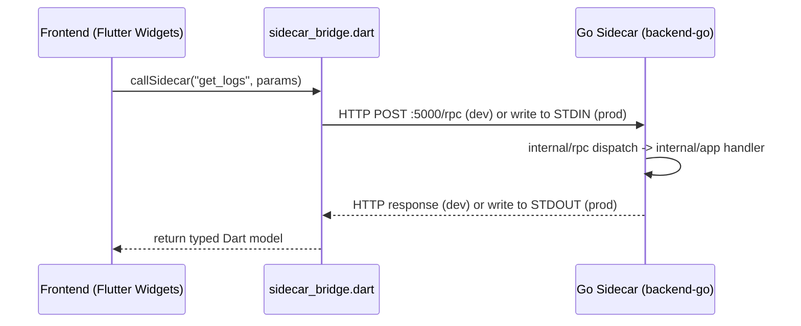

# Communication & Protocol (communication.md)

This document describes the bridging mechanism between the Flutter frontend and the Go sidecar engine, as well as the JSON-RPC 2.0 contract.

> **Migration note (2026-08)**: the transport and the JSON-RPC 2.0 contract itself are **unchanged** from the pre-migration Tauri/Python stack — only the implementations moved: the Rust IPC layer became Flutter's own subprocess/stdio bridge, and the Python `api.py` dispatcher became `backend-go/internal/rpc/`. See `docs/migration/STATUS.md` for the full record.

## 👤 Persona: `@bridge-arch`
Expert in distributed communication, JSON-RPC 2.0 specs, and low-latency bridging. Focuses on the "Flutter ↔ Go Sidecar" interface.

## 🌉 The Bridge (sidecar_bridge.dart)
LogLensAi uses a unified `callSidecar<T>` function (`flutter_app/lib/services/sidecar_bridge.dart`) to handle all communication with the sidecar. It is dual-mode:

| Path | Protocol | Purpose |
|---|---|---|
| **Development** | HTTP (Port 5000) | Local dev server for faster hot-reloading (`internal/rpc/http.go`). |
| **Production** | STDIN / STDOUT | Direct pipe between the Flutter process and the Go sidecar binary, spawned as a subprocess — respawn-then-retry-once on failure (`internal/rpc/stdio.go`). |

### Error Propagation Flow
1. **Go Error**: Caught in `internal/rpc/dispatch.go`. Returns a JSON-RPC error object with status `-32603` (Internal Error).
2. **Flutter Bridge**: `sidecar_bridge.dart` receives the response over HTTP or the stdio pipe.
3. **Dart Frontend**: `callSidecar` parses the error object and throws a detailed exception including the Go error message/stack in dev mode.

## 📡 JSON-RPC 2.0 Specification

All requests must conform to the following schema:

```json
{
  "jsonrpc": "2.0",
  "id": 123,
  "method": "<method_name>",
  "params": {
    "workspace_id": "ws_001",
    "..." : "..."
  }
}
```

### Response (Success)
```json
{
  "jsonrpc": "2.0",
  "id": 123,
  "result": { "status": "ok" }
}
```

### Response (Error)
```json
{
  "jsonrpc": "2.0",
  "id": 123,
  "error": {
    "code": -32603,
    "message": "Internal error",
    "data": "Go error detail..."
  }
}
```

## 🔐 Type-Safety Guardrails

### Struct Validation (Backend)
Every incoming request in `backend-go/internal/rpc/` is decoded into a typed Go struct defined in `internal/models/requests.go` (the Go analogue of the old Pydantic `BaseModel`s). This ensures required fields (like `workspace_id`) are present before any logic in `internal/app/handlers_*.go` runs.

### Dart Model Classes (Frontend)
Response data from `callSidecar<T>` is decoded into hand-written Dart model classes under `flutter_app/lib/models/` (`fromJson`/`toJson`, no codegen), e.g. `LogEntry` for `get_logs`.

## 🔄 Interaction Diagram (Request ↔ Response)


