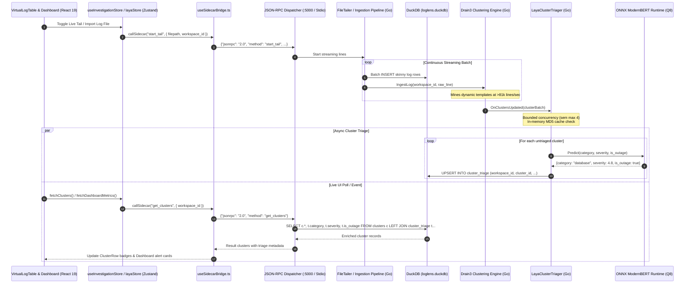
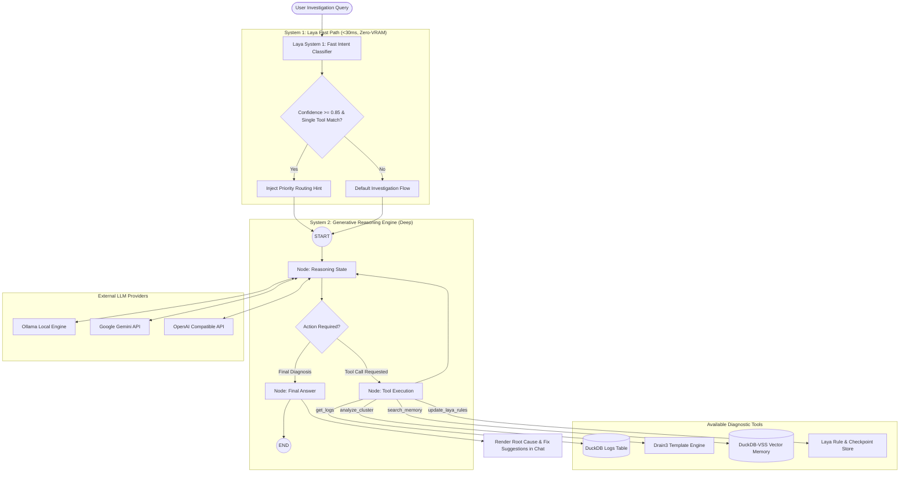
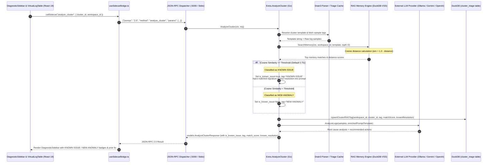
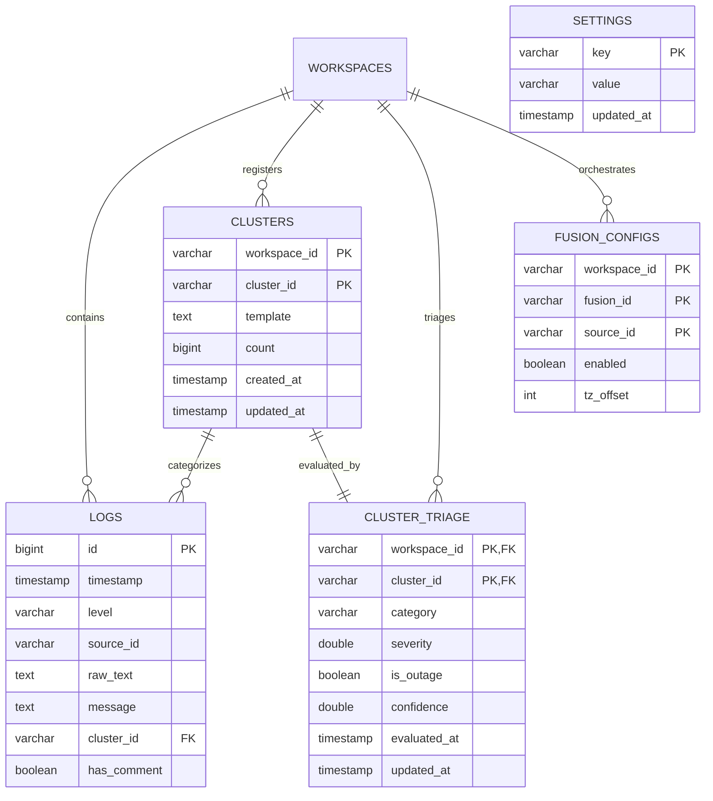
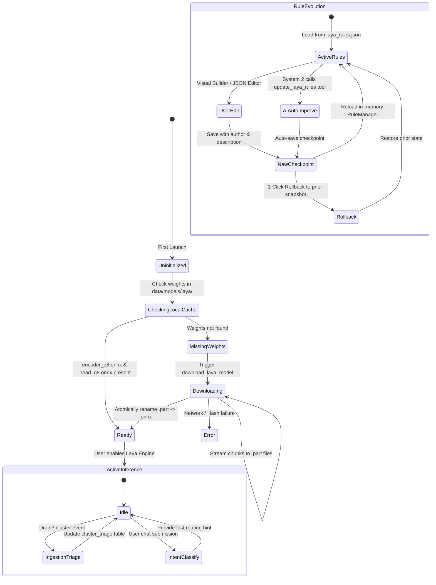

# Global Architecture Diagrams (diagrams.md)

This document is the authoritative repository for Mermaid.js diagrams illustrating the end-to-end data flows, entity relationships, and dual-engine AI orchestration across the LogLensAi ecosystem.

## 👤 Persona: `@diagram-arch`
Expert in visual architecture mapping, C4 system context, and reactive sequence modeling.

---

## 📡 1. End-to-End Log Ingestion & Real-Time Laya Triage (Sequence Diagram)

This diagram illustrates how raw logs are ingested into DuckDB, clustered by Drain3 at >81,000 lines/sec, and asynchronously triaged by Laya System 1 into categories, 1–5 severity ratings, and outage flags without blocking the main ingestion path.



---

## 🧠 2. Dual-Engine AI Investigation Architecture (State Machine & Fast Intent)

LogLensAi integrates a sub-30ms **System 1 (Laya ONNX ModernBERT)** fast classifier with a deep **System 2 (Generative LLM LangGraph)** reasoning engine.



---

## 🔍 2.1 Automatic RAG Cluster Memory Pre-Check (Sequence Diagram)

When an engineer analyzes a log cluster (or clicks "Diagnose" in the UI), `AnalyzeCluster` performs an automatic semantic similarity query against DuckDB-VSS to distinguish recurring incidents from new anomalies.



---

## 📐 3. Database Schema (Entity-Relationship Diagram)

DuckDB acts as the local columnar analytics and metadata storage engine.



---

## 🏗️ 4. Frontend Component Hierarchy (React 19 & Tailwind v4)

```mermaid
graph TD
  App[App.tsx - 3-Column Shell] --> Sidebar[Sidebar Organism]
  App --> MainContent[Main Viewport]
  App --> DiagnosticSidebar[DiagnosticSidebar Organism]

  MainContent --> InvestigationPage[InvestigationPage]
  MainContent --> DashboardPage[DashboardPage]
  MainContent --> SettingsPage[SettingsPanel Modal / Overlay]

  InvestigationPage --> LogToolbar[LogToolbar Organism]
  InvestigationPage --> VirtualLogTable[VirtualLogTable Organism]
  InvestigationPage --> ClustersPanel[Clusters List]

  LogToolbar --> SearchBar[SearchBar Molecule]
  LogToolbar --> FilterBuilder[FilterBuilder Molecule]
  LogToolbar --> TailSwitch[TailSwitch Atom]

  VirtualLogTable --> LogRow[Virtual LogRow Component]
  LogRow --> LogLevelBadge[LogLevelBadge Atom]
  LogRow --> MessageCell[Highlighted Message Text]

  ClustersPanel --> ClusterRow[ClusterRow Molecule]
  ClusterRow --> SevBadge[Severity Badge (Sev 1.0-5.0)]
  ClusterRow --> OutageBadge[Animated OUTAGE Badge]
  ClusterRow --> CatBadge[Category Badge (database/network/auth...)]

  DashboardPage --> StatTiles[Cluster & Ingestion Metrics]
  DashboardPage --> OutageAlerts[Active Outage Banner Cards]

  SettingsPage --> GeneralTab[General Preferences]
  SettingsPage --> LayaTab[LayaSettingsPanel Organism]

  LayaTab --> ModelCard[Hugging Face Model Manager & Download Bar]
  LayaTab --> EngineToggle[Zero-VRAM CPU / GPU Switch]
  LayaTab --> RuleEditor[Visual Rule Builder & JSON Code Tabs]
  LayaTab --> Timeline[Checkpoints History & 1-Click Rollback]
```

---

## 🔄 5. Laya Model Manager & Rule Checkpoint Lifecycle


